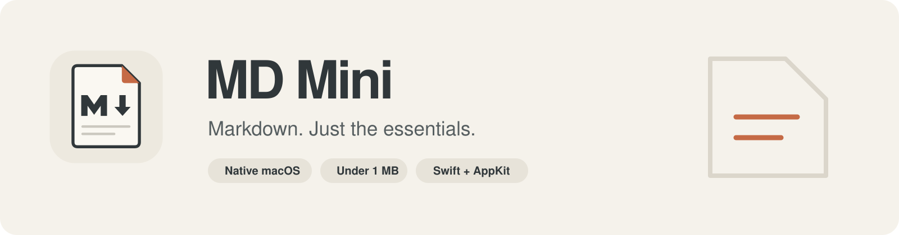
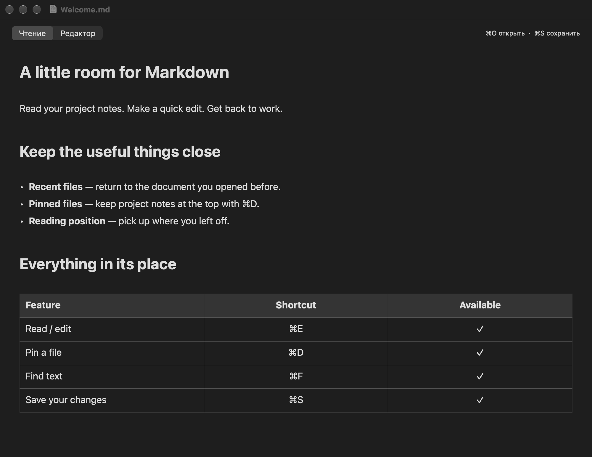
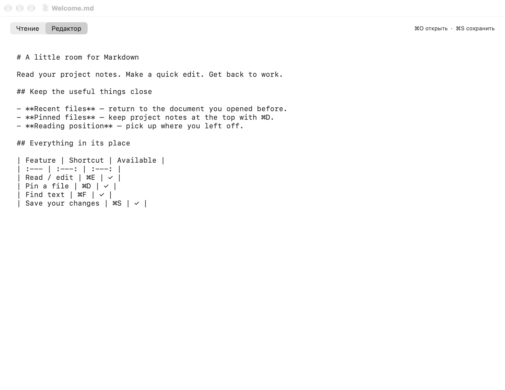

<p align="center">
  
</p>

<p align="center">
  <a href="https://github.com/fluxo159/md-mini/releases/latest"><strong>Download for Mac</strong></a>
  &nbsp; · &nbsp; <a href="README.ru.md">Русский</a>
  &nbsp; · &nbsp; <a href="#build-from-source">Build from source</a>
</p>

<p align="center">
  
  
  
</p>

A small, native app for opening a Markdown file, reading it comfortably, making a quick edit, and saving it. Built for project notes, README files, plans, and everyday `.md` documents.

**Under 1 MB installed. No Electron, embedded browser, account, or background service.** The download is for Apple Silicon; the interface is currently in Russian.

## A quiet place for your notes



*Native interface preview, rendered from the app's own views with the included sample document.*

| Make a quick stop | Pick up where you left off | Keep both versions safe |
| :--- | :--- | :--- |
| Switch between formatted reading and plain-text editing. | Reopen recent documents, pin the useful ones, and restore your reading position. | Notice external changes before reloading or saving over a different version. |

## The useful things

- **Read and edit:** headings, emphasis, lists, checkboxes, links, fenced code, and selectable Markdown tables.
- **Recent and pinned files:** the last 20 documents, with favorites kept at the top. Clearing recents keeps your pins.
- **Restore your tabs after ⌘Q:** reopen the previous tab order and active document, including unsaved drafts. Clean files are read fresh from disk.
- **Remember your place:** separate positions for reading and editing, retained between launches.
- **Notice changes on disk:** a small “Update / Later” banner when another app modifies the file. Unsaved edits require a decision; you can save a separate copy.
- **Native basics:** search, undo/redo, text sizing, multiple documents, and system light/dark appearance.
- **Plain files:** UTF-8 and BOM-marked UTF-16, with the original encoding preserved. No automatic downloads of remote images or page content.

<details>
<summary><strong>See the editor in light appearance</strong></summary>
<br>

</details>

## Get started

1. Download **MD-Mini-macOS-arm64.zip** from [Releases](https://github.com/fluxo159/md-mini/releases/latest).
2. Unzip it and move **MD Mini.app** into **Applications** or `~/Applications`.
3. Open a `.md` file with MD Mini. Use **⌘E** to switch between reading and editing.

The build is locally signed, **not Apple-notarized**; macOS may require approval in Privacy & Security before first launch. You can also build it locally using the instructions below.

To open all `.md` files with MD Mini: select one in Finder → **Get Info** → **Open with: MD Mini** → **Change All**. The app does not change that setting during installation.

### Shortcuts

| Action | Shortcut |
| :--- | :--- |
| Open a file | ⌘O |
| Open by a pasted path | ⌘⇧O |
| Save / Save as | ⌘S / ⌘⇧S |
| Read / edit | ⌘E |
| Pin / unpin current file | ⌘D |
| Previous / next tab | ⌘← / ⌘→ |
| Find | ⌘F |
| Larger / smaller text | ⌘+ / ⌘− |

**New files and Save As currently use a full-path dialog.** Ordinary ⌘S saves the open file directly. The native open dialog is also available; opening by path provides an alternative.

## Build from source

Requires macOS and Apple Command Line Tools. The project uses only system frameworks; no package installation is needed.

```sh
git clone https://github.com/fluxo159/md-mini.git
cd md-mini
./build.sh
```

The app is written to `output/MD Mini.app`. The script builds for the current Mac's architecture, targets macOS 13+, and signs the result ad hoc. The published binary is **arm64**. Tested locally on macOS 27.2.1 with Swift 6.4.2; older macOS versions and Intel Macs have not been tested.

### Checks

```sh
./Tools/check.sh
```

Checks cover encoding round trips, Markdown tables and alignment, reading-position restoration, recents and pins, ordinary saving, and an atomic external file replacement with unsaved local edits. Test preferences and files are isolated from normal app data.

## Small by design

```text
Sources/       Native app, Markdown rendering, file watching, checks
Assets/        Vector icon, PNG, and macOS icon set
Tools/         Build checks, icon generation, and documentation previews
examples/      A sample Markdown document
docs/          Interface previews and release notes
```

The reader implements a focused subset of Markdown. Images, raw HTML, Mermaid, and complex nested syntax are shown as text or simplified. After a file is moved, reopen and pin its new location. Reading-position restoration is approximate when preceding text changes. Very large documents and delayed cloud-sync behavior have not been validated.

Recent paths, pins, and reading positions are stored locally in macOS preferences. The app has no analytics or update checker. Clicking a web link opens it in your browser.

On normal quit, tabs and their text buffers are saved atomically to `~/Library/Application Support/MD Mini/session.json` with owner-only access. Unsaved drafts are kept locally, without writing over the original files. Closing an individual tab still uses the normal save/discard decision. A failed session write cancels quit. Recovery of the latest edits after a crash is not implemented.
