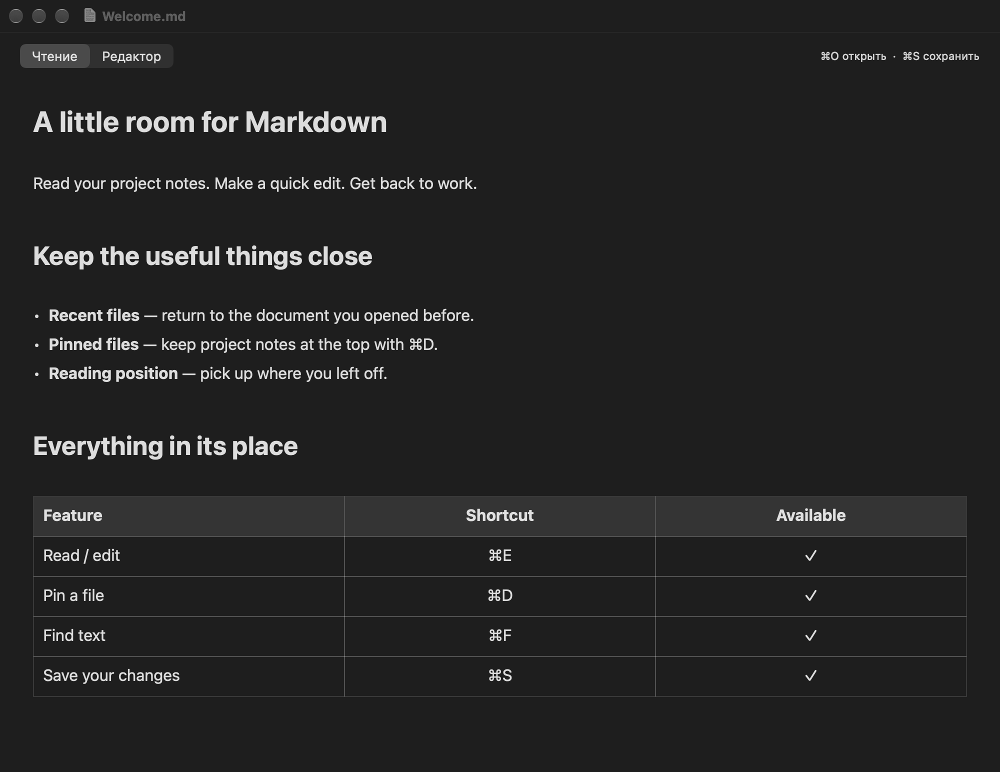
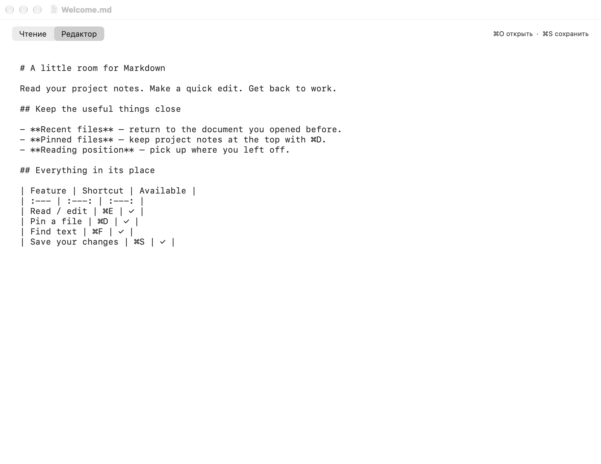

<p align="center">
  
</p>

<p align="center">
  <a href="https://github.com/fluxo159/md-mini/releases/latest"><strong>Скачать для Mac</strong></a>
  &nbsp; · &nbsp; <a href="README.md">English</a>
  &nbsp; · &nbsp; <a href="#сборка-из-исходников">Собрать из исходников</a>
</p>

Небольшое нативное приложение, чтобы открыть Markdown-файл, прочитать описание проекта, внести правки и сохранить. Подходит для README, планов, заметок и `.md`-документов.

**Меньше 1 МБ после установки. Без Electron, встроенного браузера, регистрации и фонового сервиса.** Готовая сборка — для Apple Silicon. Интерфейс на русском.

## Читать спокойно, редактировать быстро



*Превью интерфейса, отрисованное настоящими представлениями приложения на демонстрационном документе.*

| Открыть и поправить | Вернуться к нужному | Сохранить обе версии |
| :--- | :--- | :--- |
| Чтение с оформлением и редактор исходного текста. | Недавние документы, закрепления и сохранённое место чтения. | Уведомление об изменении файла и отдельная копия локальных правок. |

## Возможности

- **Чтение и редактор:** заголовки, выделение, списки, чекбоксы, ссылки, блоки кода и таблицы с выделяемым текстом.
- **Недавние и закреплённые:** последние 20 файлов; закреплённые всегда сверху. Очистка недавних сохраняет закрепления.
- **Место чтения:** восстанавливается после закрытия и перезапуска, отдельно для чтения и редактора.
- **Внешние изменения:** полоса «Обновить / Позже», если файл изменила другая программа. Несохранённые правки можно оставить, сохранить в копию или явно заменить.
- **Удобства macOS:** поиск, отмена и повтор действий, изменение размера текста, несколько документов и системная светлая/тёмная тема.
- **Обычные файлы:** UTF-8 и UTF-16 с BOM; исходная кодировка сохраняется. Внешние изображения и содержимое страниц автоматически не загружаются.

<details>
<summary><strong>Редактор в светлой теме</strong></summary>
<br>

</details>

## Установка

1. Скачайте **MD-Mini-macOS-arm64.zip** из [Releases](https://github.com/fluxo159/md-mini/releases/latest).
2. Распакуйте и перенесите **MD Mini.app** в «Программы» или `~/Applications`.
3. Откройте `.md` через MD Mini. **⌘E** переключает чтение и редактирование.

Сборка подписана локально, **без нотариального заверения Apple**. При первом запуске macOS может потребовать разрешение в разделе «Конфиденциальность и безопасность». Можно также собрать приложение самостоятельно.

Чтобы открывать все `.md` двойным кликом: выберите файл в Finder → **⌘I → «Открывать в программе: MD Mini» → «Изменить всё»**. Установка сама эту настройку не меняет.

## Горячие клавиши

| Действие | Сочетание |
| :--- | :--- |
| Открыть | ⌘O |
| Открыть по вставленному пути | ⌘⇧O |
| Сохранить / сохранить как | ⌘S / ⌘⇧S |
| Чтение / редактор | ⌘E |
| Закрепить / открепить текущий файл | ⌘D |
| Поиск | ⌘F |
| Увеличить / уменьшить текст | ⌘+ / ⌘− |

**Для нового файла и «Сохранить как…» пока используется диалог полного пути.** Обычное ⌘S сохраняет открытый файл сразу. Для открытия есть системный диалог и запасной вариант со вставкой пути.

## Сборка из исходников

Нужны macOS и Apple Command Line Tools. Только системные библиотеки, без установки пакетов.

```sh
git clone https://github.com/fluxo159/md-mini.git
cd md-mini
./build.sh
```

Результат — `output/MD Mini.app`. Скрипт собирает приложение под архитектуру текущего Mac с целевой версией macOS 13+ и локальной подписью. Готовый ZIP содержит **arm64**-сборку. Локально проверено на macOS 27.2.1 и Swift 6.4.2; старые версии macOS и Intel Mac отдельно не проверялись.

### Проверки

```sh
./Tools/check.sh
```

Проверяются кодировки, таблицы и выравнивание, позиция чтения, недавние и закреплённые файлы, сохранение и атомарная внешняя замена с несохранёнными локальными правками. Настройки и файлы тестов изолированы от обычных данных приложения.

## Ограничения и локальные данные

Поддерживается базовое подмножество Markdown. Изображения, HTML, Mermaid и сложная вложенная разметка отображаются текстом или упрощённо. После переноса файла нужно открыть и закрепить новый путь. Если текст перед сохранённой позицией изменился, место чтения может сдвинуться. Очень большие документы и задержки облачной синхронизации отдельно не проверялись.

Пути недавних файлов, закрепления и позиции хранятся локально в настройках macOS. В приложении нет аналитики и проверки обновлений. Нажатие на веб-ссылку открывает браузер.
